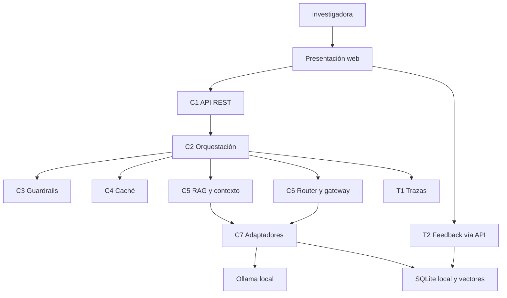
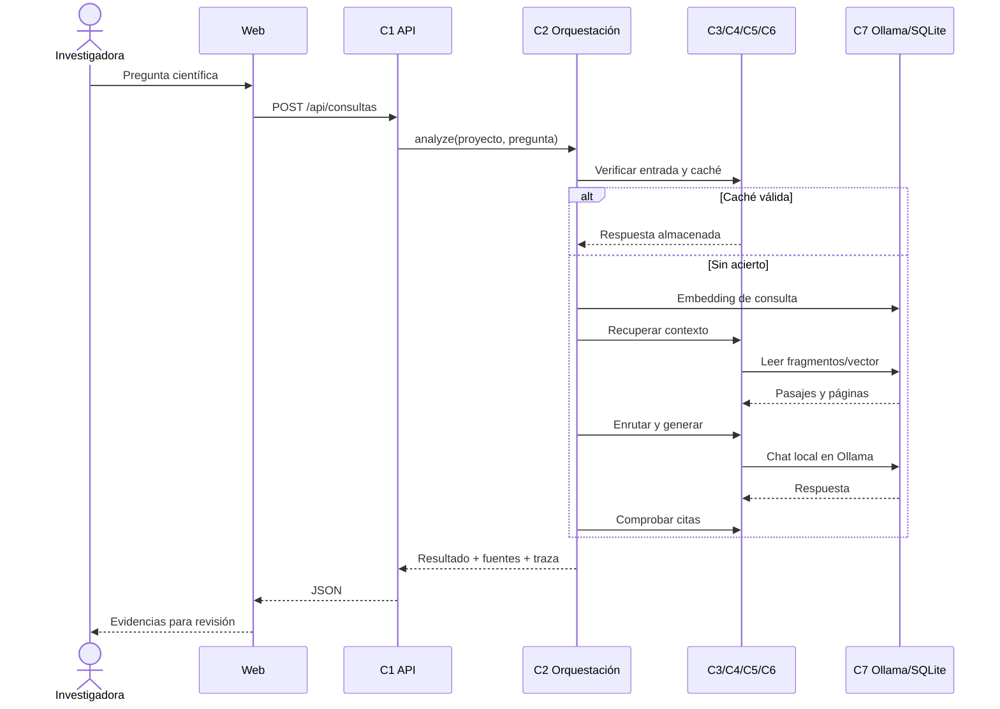

# Arquitectura implementada — MatriScope 0.1

Documento de código, no informe de resultados. Se describe la **primera fase** y sus límites.

## Contenedores y dependencias

La aplicación web se comunica **exclusivamente** con C1 mediante HTTP. Los modelos
no son accesibles directamente desde el navegador. La presentación y el servicio
corren en el mismo origen HTTP para esta versión local.

## Secuencia ejecutable: consulta RAG

## Decisiones y controles de la fase

- **C1:** validación de datos JSON/Form y códigos HTTP de error.
- **C2:** reformulación conservadora con número máximo de iteraciones.
- **C3:** validación de longitud/caracteres e intentos explícitos de alterar
  instrucciones; salida con esquema y referencias válidas. Esto no constituye
  un control exhaustivo de seguridad.
- **C4:** caché exacta y semántica con expiración. La huella de corpus y los
  parámetros principales se incluyen para evitar reutilización indebida.
- **C5:** fragmentación que conserva número de página y recuperación por coseno.
- **C6:** ruta inicial por tipo de operación con modelo de respaldo.
- **C7:** adaptadores locales para Ollama y SQLite; aún falta un motor vectorial
  optimizado para escalabilidad.
- **T1/T2:** traza por consulta, métricas agregadas, opinión útil/no útil.

## Elementos que no se deben presentar como terminados

Selección experimental de modelos, calibración de umbrales, evaluación de corpus,
latencia por capa, revisión humana persistida por afirmación, exportación
científica y diagramas de secuencia correspondientes a caché, bloqueo,
ingesta y ciclo de agente aún necesitan pruebas y desarrollo adicional.

